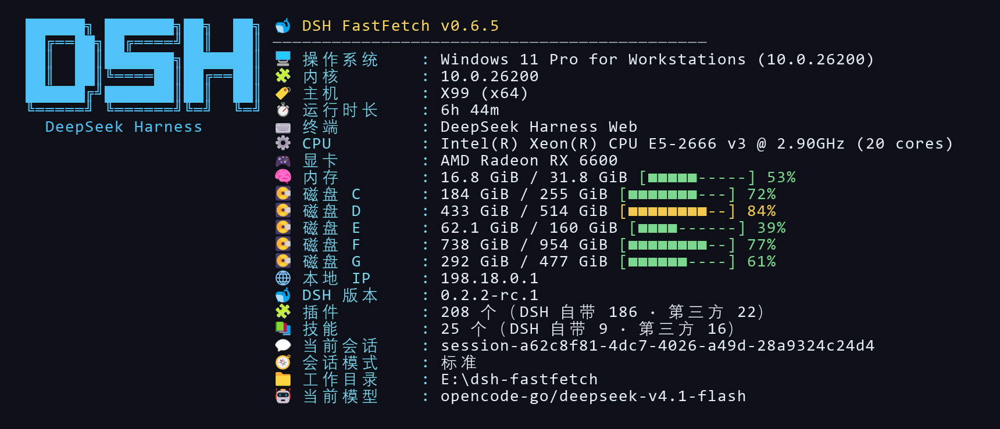

# dsh-fastfetch

English | [简体中文](https://github.com/Niesc-F/dsh-fastfetch/blob/master/README.md)

A fastfetch-style system information panel for DSH: one command and one tool that print a snapshot of the machine and the running DSH environment.



## Features

- The slash command and the AI tool share one core, so both print the same thing
- System: OS, kernel, host, uptime, shell, terminal, CPU, GPU, memory, every disk, local IP, date, locale
- DSH: version, session mode (Standard / PTC / Minimal / Cordis), current model, plugin and skill counts split into built-in and third-party, current session, working directory
- Settings page: a FastFetch panel inside DSH Settings edits the configuration
- Cross-platform: verified on Windows; macOS and Linux are implemented but **not verified on real hardware**
- No runtime dependencies, pure ESM

## Install

Requires the DeepSeek Harness desktop app.

**Option 1: install inside DSH (recommended)**

1. Open **Plugins → Add plugin** in the DSH sidebar (or the arrow next to it, then "Install third-party plugin").
2. Paste this repository's URL and click **Install**:

   ```
   https://github.com/Niesc-F/dsh-fastfetch
   ```

3. Click **Enable now** once it finishes. If no "FastFetch" entry shows up in Settings, quit DSH completely and open it again.

**Option 2: command line**

```bash
dsh plugin --profile desktop add https://github.com/Niesc-F/dsh-fastfetch
```

When `dsh` is not on your PATH, use the full path inside the DSH install directory: `& "<DSH install dir>\resources\runtime\cli\bin\dsh.cmd" plugin --profile desktop add https://github.com/Niesc-F/dsh-fastfetch`.

**Upgrading**: third-party plugins are upgraded by uninstalling and reinstalling; the configuration lives in the profile's `cordis.patch.yml` and survives an uninstall.

**Local development**: `git clone` the repo and install with `dsh plugin --profile desktop add link:<clone dir>`. Code changes take effect directly (host-side changes need a DSH restart; editing only `client.js` needs just a page refresh).

## Usage

### Slash command

```text
/fastfetch
/fastfetch --category dsh
/fastfetch -s os:kernel:cpu:memory:disk --no-logo
/fastfetch --format json
/fastfetch --list-modules
/fastfetch --help
```

`/ff` is the same command under a shorter name, with identical options and output:

```text
/ff
/ff --category dsh
```

### AI tool

Tool name `fastfetch`:

| Parameter | Type | Description |
| --- | --- | --- |
| `modules` | string[] | Module ids and order; defaults to the stored configuration |
| `category` | `all` `system` `dsh` | Show system or DSH information only |
| `logo` | boolean | Whether to draw the DSH wordmark |
| `icons` | `emoji` `none` | Icon style |
| `color` | `auto` `always` `never` | Color mode; the tool defaults to `never` |
| `format` | `text` `json` | Output format |
| `width` | integer | Output width; 0 means automatic (100 columns) |

## Configuration

### Settings page

Open **Settings → FastFetch**. It edits appearance, numeric options, module toggles, DSH sections and thresholds. The same settings apply to `/fastfetch`, `/ff` and the `fastfetch` tool — all three share one configuration. Only values that differ from the defaults are written back.

There is no font switch — the card font is hardcoded: the info column prefers `Sarasa Mono SC`, then `Maple Mono CN`, then the system monospace font; the wordmark stays on Consolas because its block glyphs fall apart in any other font. For strict CJK/Latin monospace (a Chinese glyph exactly two Latin cells wide, so colons line up), install [Sarasa Mono SC](https://github.com/be5invis/Sarasa-Gothic/releases) or [Maple Mono CN](https://github.com/subframe7536/maple-font) and it is picked up automatically. Both are SIL OFL 1.1, free to use commercially and to redistribute.

### Configuration file

Stored in the profile's `cordis.patch.yml`:

```yaml
- id: dsh-fastfetch
  name: dsh-fastfetch
  config:
    display:
      logo: dsh
      separator: ' = '
    dsh:
      showSkills: false
    general:
      timeoutMs: 2000
```

See [docs/CONFIG.md](docs/CONFIG.md) for every field and default.

## Modules

| Module | Category | Default | Description |
| --- | --- | --- | --- |
| `title` | system | yes | Title row |
| `separator` | system | yes | Divider |
| `os` | system | yes | Operating system |
| `kernel` | system | yes | Kernel version |
| `host` | system | yes | Hostname and architecture |
| `uptime` | system | yes | Uptime |
| `cpu` | system | yes | CPU model and core count |
| `gpu` | system | yes | Graphics adapter |
| `memory` | system | yes | Memory usage with bar |
| `disk` | system | yes | Usage of every drive or partition |
| `localip` | system | yes | Local IPv4 address |
| `shell` | system | no | Current shell |
| `terminal` | system | yes | Terminal program |
| `datetime` | system | no | Date and time |
| `locale` | system | no | Locale |
| `dsh-version` | dsh | yes | DSH version |
| `dsh-plugins` | dsh | yes | Enabled plugins, built-in vs third-party |
| `dsh-skills` | dsh | yes | Enabled skills, built-in vs third-party |
| `dsh-session` | dsh | yes | Current session id |
| `dsh-mode` | dsh | yes | Current session mode |
| `dsh-cwd` | dsh | yes | Current working directory |
| `dsh-model` | dsh | yes | Current model |

Run `/fastfetch --list-modules` for the live list.


## Platform support

| Platform | Status |
| --- | --- |
| Windows | Verified on Windows 11 hardware |
| Linux | Implemented, including distribution detection; **not verified on hardware** |
| macOS | Implemented; **not verified on hardware** |

Disk enumeration, distribution detection and logo output on macOS and Linux have never run on real machines. Please report actual output if something differs.

## Development

```bash
npm test
```

`node --test`, no external dependencies.

## Layout

```text
dsh-fastfetch/
├── index.js              # Host entry: command, tool, configuration API
├── client.js             # Client entry: command card, settings page
├── cordis.patch.yml      # Bundle patch
├── src/
│   ├── config.js         # Defaults and normalization
│   ├── config-api.js     # Settings page read/write channel
│   ├── cli.js            # Argument parsing
│   ├── core.js           # Collection and rendering
│   ├── context.js        # DSH context reads
│   ├── i18n.js           # Copy
│   ├── modules/          # Module implementations and registry
│   ├── render/           # Text, color, bars, JSON
│   └── util/             # Unit formatting, subprocess
├── locale/               # Plugin display name and description
├── docs/CONFIG.md        # Configuration reference
└── test/                 # node:test cases
```

## References

- [fastfetch](https://github.com/fastfetch-cli/fastfetch) — Output style reference (MIT)
- [neofetch](https://github.com/dylanaraps/neofetch) — The classic shape of a system information panel
- [DeepSeek Harness](https://github.com/deepseek-ai) — Plugin runtime and Client/Host interfaces

## License

MIT
