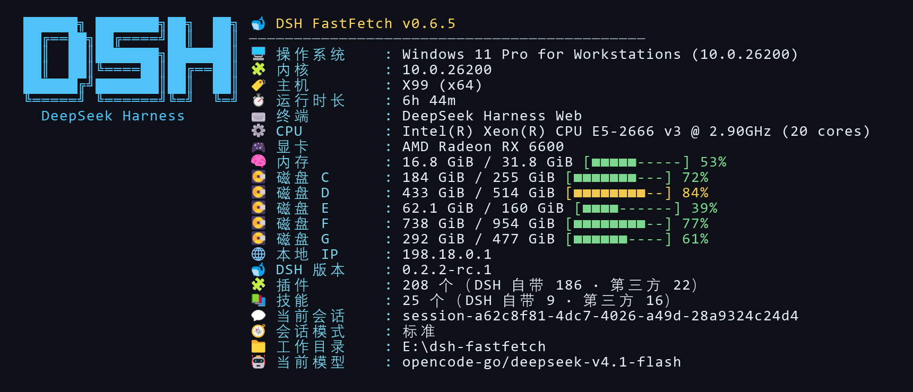

# dsh-fastfetch

[English](https://github.com/Niesc-F/dsh-fastfetch/blob/master/README.en.md) | 简体中文

fastfetch 风格的 DSH 系统信息面板：一条命令 / 一个工具，输出系统信息与 DSH 运行环境快照。



## 特性

- 斜杠命令与 AI 工具共用同一套核心，输出一致
- 系统信息：操作系统、内核、主机、运行时长、Shell、终端、CPU、显卡、内存、全部磁盘、本地 IP、日期、区域
- DSH 信息：版本、会话模式（标准 / PTC / 极简 / Cordis）、当前模型、插件与技能数量（区分自带与第三方）、当前会话、工作目录
- 设置页：DSH 设置里的 Fastfetch 面板可直接改配置
- 跨平台：Windows 已验证；macOS 与 Linux 已实现但**未在真机验证**
- 零运行时依赖，纯 ESM

## 安装

需要 DeepSeek Harness 桌面版。

**方式一：在 DSH 里装（推荐）**

1. 打开 DSH 侧栏的 **插件 → 添加插件**（或点箭头选「安装第三方插件」）。
2. 把本仓库地址粘进输入框，点 **安装**：

   ```
   https://github.com/Niesc-F/dsh-fastfetch
   ```

3. 装好后点 **立即启用**。设置里没出现「FastFetch」的话，完全退出 DSH 再打开一次。

**方式二：命令行**

```bash
dsh plugin --profile desktop add https://github.com/Niesc-F/dsh-fastfetch
```

`dsh` 不在 PATH 上时，用 DSH 安装目录里的完整路径：`& "<DSH 安装目录>\resources\runtime\cli\bin\dsh.cmd" plugin --profile desktop add https://github.com/Niesc-F/dsh-fastfetch`。

**升级**：第三方插件通过「卸载 → 重新安装」升级；配置写在 profile 的 `cordis.patch.yml` 里，卸载不会删掉。

**本地开发**：`git clone` 下来后用 `dsh plugin --profile desktop add link:<克隆目录>` 安装，改代码直接生效（宿主端改动需重启 DSH，只改 `client.js` 刷新页面即可）。

## 使用

### 斜杠命令

```text
/fastfetch
/fastfetch --category dsh
/fastfetch -s os:kernel:cpu:memory:disk --no-logo
/fastfetch --format json
/fastfetch --list-modules
/fastfetch --help
```

`/ff` 是同一个命令的短名字，参数与输出完全一致，日常敲这个更快：

```text
/ff
/ff --category dsh
```

### AI 工具

工具名 `fastfetch`，参数：

| 参数 | 类型 | 说明 |
| --- | --- | --- |
| `modules` | string[] | 模块 id 及顺序，省略用持久配置 |
| `category` | `all` `system` `dsh` | 只显示系统或 DSH 信息 |
| `logo` | boolean | 是否显示 DSH 字标 |
| `icons` | `emoji` `none` | 图标风格 |
| `color` | `auto` `always` `never` | 颜色模式，工具默认 `never` |
| `format` | `text` `json` | 输出格式 |
| `width` | integer | 输出宽度，0 为自动（100 列） |

## 配置

### 设置页

打开 **设置 → FastFetch**，可直接调整外观、数值、模块开关、DSH 信息项与告警阈值。这份设置同时作用于 `/fastfetch`、`/ff` 和 `fastfetch` 工具，三者共用一份配置。保存时只写入与默认值不同的字段。

设置页里没有字体开关，卡片字体是写死的：信息区优先 `Sarasa Mono SC`（更纱黑体），其次 `Maple Mono CN`，再回退系统等宽字体；字标固定走 Consolas 那组，因为块字符换字体就会散架。想要中英文严格等宽（中文正好占两格、冒号能对齐），装一份 [更纱黑体 Sarasa Mono SC](https://github.com/be5invis/Sarasa-Gothic/releases) 或 [Maple Mono CN](https://github.com/subframe7536/maple-font) 就会自动生效。两者都是 SIL OFL 1.1 许可，可商用、可随项目分发。

### 配置文件

写在 profile 的 `cordis.patch.yml` 中：

```yaml
- id: dsh-fastfetch
  name: dsh-fastfetch
  config:
    display:
      logo: dsh
      separator: ' = '
    dsh:
      showSkills: false
    general:
      timeoutMs: 2000
```

完整字段与默认值见 [docs/CONFIG.md](docs/CONFIG.md)。

## 模块

| 模块 | 分类 | 默认 | 说明 |
| --- | --- | --- | --- |
| `title` | system | 是 | 标题行 |
| `separator` | system | 是 | 分隔线 |
| `os` | system | 是 | 操作系统 |
| `kernel` | system | 是 | 内核版本 |
| `host` | system | 是 | 主机名与架构 |
| `uptime` | system | 是 | 运行时长 |
| `cpu` | system | 是 | CPU 型号与核心数 |
| `gpu` | system | 是 | 显卡型号 |
| `memory` | system | 是 | 内存用量与进度条 |
| `disk` | system | 是 | 所有盘符 / 分区用量 |
| `localip` | system | 是 | 本地 IPv4 地址 |
| `shell` | system | 否 | 当前 Shell |
| `terminal` | system | 是 | 终端程序 |
| `datetime` | system | 否 | 日期时间 |
| `locale` | system | 否 | 区域设置 |
| `dsh-version` | dsh | 是 | DSH 版本 |
| `dsh-plugins` | dsh | 是 | 已启用插件数（自带 / 第三方） |
| `dsh-skills` | dsh | 是 | 已启用技能数（自带 / 第三方） |
| `dsh-session` | dsh | 是 | 当前会话 id |
| `dsh-mode` | dsh | 是 | 当前会话模式 |
| `dsh-cwd` | dsh | 是 | 当前工作目录 |
| `dsh-model` | dsh | 是 | 当前模型 |

`/fastfetch --list-modules` 查看实时清单。


## 平台支持

| 平台 | 状态 |
| --- | --- |
| Windows | 已在 Windows 11 实机验证 |
| Linux | 已实现（含各发行版识别），**未实机验证** |
| macOS | 已实现，**未实机验证** |

macOS 与 Linux 的磁盘枚举、发行版识别与磁盘挂载点标签均未在真机跑过，遇到问题请按实际输出反馈。

## 开发与测试

```bash
npm test
```

`node --test`，无外部依赖。

## 目录结构

```text
dsh-fastfetch/
├── index.js              # Host 入口：命令、工具、配置 API
├── client.js             # Client 入口：命令卡片、设置页
├── cordis.patch.yml      # bundle patch
├── src/
│   ├── config.js         # 默认配置与归一化
│   ├── config-api.js     # 设置页读写通道
│   ├── cli.js            # 参数解析
│   ├── core.js           # 采集与渲染编排
│   ├── context.js        # DSH 上下文读取
│   ├── i18n.js           # 文案
│   ├── modules/          # 模块实现与注册表
│   ├── render/           # 文本、颜色、进度条、JSON
│   └── util/             # 单位格式化、子进程
├── locale/               # 插件显示名与描述
├── docs/CONFIG.md        # 配置参考
└── test/                 # node:test 用例
```

## 参考项目

- [fastfetch](https://github.com/fastfetch-cli/fastfetch) — 输出风格参考（MIT）
- [neofetch](https://github.com/dylanaraps/neofetch) — 系统信息面板的经典形态
- [DeepSeek Harness](https://github.com/deepseek-ai) — 插件运行时与 Client/Host 接口

## 许可

MIT
